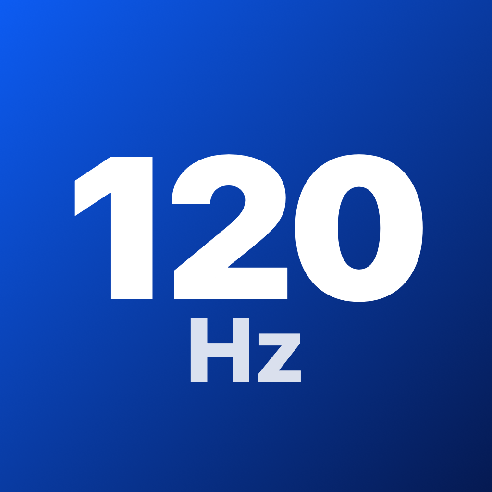

<p align="center">
  
</p>

# 一鍵高刷 GlobalRefresh Lite

> 精簡自 [Yoroin/GlobalRefresh-PiP](https://github.com/Yoroin/GlobalRefresh-PiP) 1.1.1，原始 Demo 為 [CaiWanFeng/PiP](https://github.com/CaiWanFeng/PiP)。

只保留一個功能：按一下「開啟 120Hz」，App 會開啟 VideoCall 畫中畫懸浮窗，懸浮窗出現後自動縮到 0.1pt 隱藏，讓 ProMotion 螢幕上原本被限制在約 80Hz 的 App 恢復最高 120Hz 的自適應刷新率表現。

## 和上游的差異

- **刪除**：教學與啟動動畫、更新日誌與版本檢測、幀率演示頁、時鐘／網速／FPS 懸浮窗、PlayerLayer 與音訊保活等其他模式、快捷指令與 URL scheme、通知、調試日誌與診斷、深色模式開關、高度滑桿與記憶高度等。
- **保留**：上游 1.1.1 預設組合「VideoCall + 僅 PiP 保活」的完整核心鏈（見下方原理）。
- **新增**：一張精簡狀態卡片，顯示狀態、懸浮窗高度、本次運行時間與螢幕最高刷新率。

## 原理

沿用上游 1.1.1 的預設組合，各環節如下：

| 環節 | 作法 | 檔案 |
| --- | --- | --- |
| 懸浮窗容器 | `AVPictureInPictureVideoCallViewController` + `ContentSource(activeVideoCallSourceView:contentViewController:)`，以 300×44pt 啟動 | `PiPEngine.swift` |
| 自動隱藏 | `didStart` 後同步把 `preferredContentSize` 與 source view 約束縮到 0.1pt | `PiPEngine.swift` |
| 內容更新 | 懸浮窗內容以 60fps `CADisplayLink` 持續捲動文字，縮到 0.1pt 後也不停止；懸浮窗本身不再嚴格請求 120Hz（`requests120 = false`） | `PiPHiddenReference.swift` |
| App 刷新請求 | 前台 DisplayLink 嚴格請求 120Hz；後台有懸浮窗時保留 DisplayLink 但不指定幀率範圍；`Info.plist` 開啟 `CADisableMinimumFrameDurationOnPhone` | `PiPEngine.swift`（`RefreshDriver`）、`Info.plist` |
| 控制項樣式 | 建構期間 `_proxyControlsStyle` 回傳 5；建構後以 KVC 設定 `controlsStyle`（iOS 16+ 為 2，iOS 15 為 1） | `PiPHiddenReference.swift`、`PiPEngine.swift` |
| 共存保護 | 內容類型 provider：啟動時為 4，`didStart` 1 秒後提交一次 6 | `PiPHiddenReference.swift` |
| 保活 | 只靠畫中畫，不播放任何音訊；`UIBackgroundModes = audio` 是畫中畫本身需要的宣告 | `Info.plist` |

`PiPHiddenReference.swift` 移植自上游的 `PiPCoexistenceExperiment.swift`，只刪除了日誌、write-trace 診斷與時鐘模式，私有介面的簽名校驗、作用域與退場邏輯維持原樣。

## 使用方式

1. 打開 App，按「開啟 120Hz」。
2. 懸浮窗出現後會自動縮到 0.1pt，狀態卡片顯示「運行中 · 已隱藏」，之後切回其他 App 即可。
3. 要關閉時回到 App 按「關閉」。

## 實機驗證紀錄

| 裝置 | 系統 | 結果 |
| --- | --- | --- |
| iPhone Air | iOS 27.0.1 | 開啟 → 1 秒內進入運行中並縮到 0.1pt → 關閉 → 再次開啟 → 關閉，流程皆正常 |

以上以 console log 驗證啟動流程，未量測實際刷新率；其他機型與 iOS 版本尚未驗證。

## 已知限制

- 只支援 iOS 15–27（與上游預設組合的開放範圍一致），需要 ProMotion 螢幕；60Hz 螢幕或本身鎖 60 幀的內容無法提升。
- 使用系統內部介面（私有 API），不適合上架 App Store；iOS 更新後可能失效。失效時 App 會取消啟動並提示，不會退回其他方案。
- 懸浮窗沒有先拖到側邊就直接縮小：上游 1.1.1 表示已修正這種情況下無法自動熄屏的問題，本精簡版沿用同一實作，但尚未獨立驗證。
- 畫中畫保活不是永久後台權限，仍可能因記憶體壓力或系統策略被終止；懸浮窗被關閉後回到 App 會提示重新開啟。

## 自簽安裝

[Releases](../../releases) 提供未簽名 IPA，可用 AltStore、Sideloadly、TrollStore、牛蛙助手等工具，以自己的 Apple ID 或證書簽名安裝。

## 自行建置

```bash
# 可選：修改 project.yml 後重新產生專案（已附 GlobalRefreshLite.xcodeproj）
xcodegen generate

# 產生未簽名 IPA 與 SHA256SUMS 到 build/
./scripts/build_unsigned_ipa.sh
```

以 Xcode 27.0 建置驗證，部署目標 iOS 15.0，不依賴 CocoaPods。

## 致謝與署名

- 原始 Demo 專案：[CaiWanFeng/PiP](https://github.com/CaiWanFeng/PiP)，原作者 CaiWanFeng
- 高刷、隱藏、保活與共存保護的開發與維護：[Yoroin/GlobalRefresh-PiP](https://github.com/Yoroin/GlobalRefresh-PiP)，Yoroin
- 本精簡版：[iceorange-dev/GlobalRefresh-Lite](https://github.com/iceorange-dev/GlobalRefresh-Lite)

依上游 NOTICE 要求，修改、散佈或發佈基於本專案的 App 時，請保留 CaiWanFeng 與 Yoroin 的署名及對應專案連結。

## 授權

上游專案沒有附開源授權條款，因此本專案也不另附授權；使用與散佈請遵守 [NOTICE](NOTICE)。

## 免責聲明

本專案僅供學習、研究與個人裝置測試。安裝、簽名與使用的風險由使用者自行承擔，請勿用於違反平台規則或其他不當用途。
